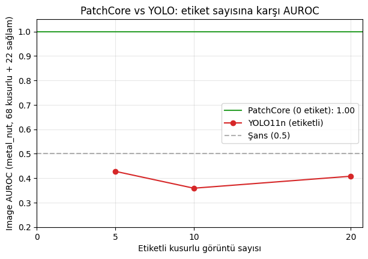
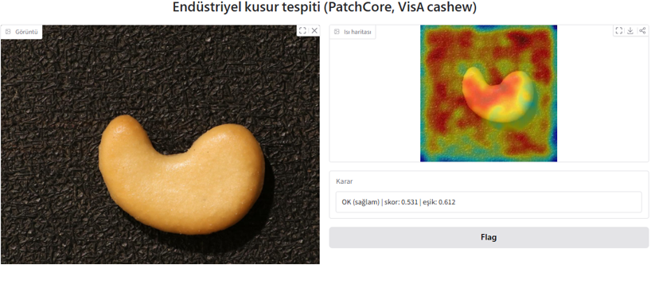
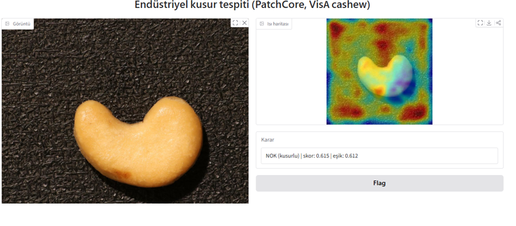

# Industrial Anomaly Detection: PatchCore vs. Supervised YOLO

Unsupervised visual defect detection trained only on defect-free images (PatchCore and PaDiM via
[anomalib](https://github.com/open-edge-platform/anomalib) 2.7.0), compared against supervised YOLO11n with few labels.
It also includes a multi-seed evaluation with a validation-based threshold, a simulated lighting-shift test,
pixel-level evaluation, an ONNX CPU benchmark, and a Gradio demo.

> **Scope note:** I used anomalib's implementations; I did not re-implement PatchCore from scratch.
> I did not collect my own data: lighting changes are **simulated** brightness scaling, not real lighting variation.

## Key findings

- **Unsupervised works with zero defect labels.** PatchCore reached a mean image AUROC of **0.988** on 4 MVTec AD categories and **0.859** on 4 VisA categories (anomalib default settings, single runs).
- **YOLO11n with 5-20 labeled defects stayed near chance** (image AUROC 0.36-0.43) on MVTec `metal_nut`, while PatchCore on the same 90 test images scored 1.0. This holds for *this setup* (untuned training, one category), not for YOLO in general.
- **Ranking quality is stable, the operating point is not.** On VisA `cashew` (5 seeds), image AUROC was 0.961 ± 0.004, but a threshold chosen from a held-out validation set gave recall between 0.64 and 0.80 depending on the seed.
- **A fixed threshold does not survive brightness changes.** AUROC stayed at 0.953-0.968 for brightness x0.5-x1.5 (3 seeds), but the false-alarm rate rose from 1.3% to 17-24% (x1.25, x0.5) and 95% (x1.5).
- **Pixel-level localization is good:** pixel AUROC ≈ 0.991 on `cashew` (3 seeds), with a class-imbalance caveat (see below).
- **PatchCore is slow on CPU:** about 1 FPS in my Kaggle CPU environment (ONNX Runtime ~1.2 FPS vs PyTorch ~0.95 FPS).

## Results

Image AUROC values were computed manually with `sklearn.metrics.roc_auc_score` from per-image anomaly scores.
PatchCore's coreset sampling is random, so small differences between runs are expected. Sections 1-3 are single runs; sections 4 and 5 use multiple seeds.

### 1. PatchCore vs. PaDiM on MVTec AD (full test sets, single run)

| Category | PatchCore | PaDiM |
|---|---|---|
| metal_nut | 0.997 | 0.998 |
| leather | 1.000 | 1.000 |
| screw | 0.961 | 0.956 |
| transistor | 0.993 | 0.994 |
| **Mean** | **0.988** | **0.987** |

The two models are indistinguishable on these categories (differences of 0.001-0.005 on small test sets). `screw` is the hardest category for both.
PatchCore anomaly maps overlap the ground-truth masks on the `metal_nut` examples I inspected (6 samples, all one defect type, so not representative of all defect types).

### 2. PatchCore (0 labels) vs. YOLO11n (5/10/20 labels), MVTec `metal_nut`

| Labeled defective images | YOLO11n image AUROC | PatchCore image AUROC |
|---|---|---|
| 0 | n/a | 1.000 |
| 5 | 0.428 | 1.000 |
| 10 | 0.359 | 1.000 |
| 20 | 0.408 | 1.000 |

**Protocol**
- YOLO labels: bounding boxes derived from MVTec ground-truth masks (`findContours` + `boundingRect`), single class "defect".
- Each training set: n defective + n defect-free images (empty labels). Defective training/validation images came from MVTec's test set and were **excluded from evaluation**.
- Evaluation: the same 90 images for both methods (68 defective + 22 good). YOLO image score = highest box confidence (0 if no box), `conf=0.001`.
- YOLO11n fine-tuned from COCO weights: 100 epochs, patience 30, imgsz 640, batch 8, 10-image validation set.

**Diagnosis:** the YOLO models drew many large, overlapping high-confidence boxes on good and defective images alike (mean top score 0.897 defective vs. 0.915 good for n=20). They appear to have learned "nut present = defect"; this is an interpretation from a few visualized samples, not a proven cause.

**Limits:** one category, one seed, no hyperparameter tuning, tiny validation set. I did not test larger label counts, so the point where YOLO catches up (if any) was not found.

**A bug I caught:** files from different defect folders share names (`000.png`), so my first dataset build silently overwrote images (n=10 became 8, n=20 became 15). I fixed the naming, rebuilt the datasets, verified the counts (5/10/20) and retrained.

### 3. PatchCore on VisA (full test sets, anomalib default settings, single run)

| Category | Image AUROC |
|---|---|
| cashew | 0.966 |
| capsules | 0.735 |
| pcb1 | 0.931 |
| macaroni1 | 0.807 |
| **Mean** | **0.859** |

Performance drops substantially on `capsules` and `macaroni1` (small defects, multi-object scenes). I did not tune resolution or layers, so I cannot say whether this is a model limit or a settings limit.

### 4. Robust evaluation (VisA `cashew`, multiple seeds)

**Protocol.** `train/good` was split 80/20: 360 images for training (memory bank) and 90 held-out validation images the model never saw. The decision threshold is the **95th percentile of validation scores** (target false-alarm rate ≈ 5%). Test: 50 good + 100 defective images, untouched during threshold selection. The seed changes the train/validation split and PatchCore's coreset sampling.

| Metric (5 seeds) | Mean ± std |
|---|---|
| Image AUROC | 0.961 ± 0.004 |
| Precision | 0.985 ± 0.019 |
| Recall | 0.718 ± 0.065 |
| False-alarm rate | 0.024 ± 0.033 |
| F1 | 0.829 ± 0.030 |

- AUROC is stable (0.957-0.965). The threshold is not: it ranged 0.55-0.64, and recall 0.64-0.80, because it rests on the tail of only ~90 validation images.
- The realized false-alarm rate (2.4%) was below the 5% target, so this threshold rule was conservative on this data.
- **Upper bound (not deployable):** if the threshold were set on the test good images, recall would be 0.76-0.80 at 2-5% false alarms and 0.83-0.90 at 10%. This shows the model's ceiling, not an achievable operating point.
- The std is computed over 5 seeds and does not include test-set sampling uncertainty (50 good images: one image is 2 percentage points).

(The single-run value 0.966 in section 3 used all 450 training images and one split, so it differs slightly from this 360-image protocol.)

### 5. Simulated lighting shift (VisA `cashew`, 3 seeds: 0, 1, 4)

The model and threshold come from section 4 (threshold chosen at normal lighting on validation data and **kept fixed**). Test images were multiplied by a brightness factor (clipped to 0-255).

| Brightness | AUROC | False-alarm rate | Recall |
|---|---|---|---|
| x0.5 | 0.965 ± 0.003 | 0.240 ± 0.131 | 0.940 ± 0.072 |
| x0.75 | 0.964 ± 0.003 | 0.033 ± 0.042 | 0.747 ± 0.081 |
| x1.0 | 0.960 ± 0.003 | 0.013 ± 0.023 | 0.713 ± 0.080 |
| x1.25 | 0.968 ± 0.003 | 0.173 ± 0.103 | 0.910 ± 0.056 |
| x1.5 | 0.953 ± 0.004 | 0.947 ± 0.076 | 1.000 ± 0.000 |

Recall 1.0 with 95% false alarms means the system flags everything, not that it works.
Takeaway: AUROC (threshold-free ranking) hides a failure that appears once a fixed threshold is used, so controlled lighting or normalization is needed in practice.
**Limits:** uniform brightness scaling is not real lighting variation (no shadows, reflections, color temperature); x1.0 used original JPGs while other factors used PNG copies (format effect not measured); 3 seeds; one category.

### 6. Pixel-level evaluation (VisA `cashew`, 3 seeds)

Pixel AUROC ≈ **0.991** (0.9907, 0.9908, 0.991). Anomaly maps were compared with the VisA ground-truth masks; masks were downsampled to the map resolution (nearest neighbor) and good images were included with empty masks.
Only **1.1%** of pixels are defective, so this number can hide missed small defects; it should not be read as "defects are localized perfectly". PRO was not computed.

### 7. `engine.test` vs. manual AUROC

In a clean session, anomalib's `engine.test` and the manual `roc_auc_score` agreed (0.9664 on both). Note that anomalib's `Folder` datamodule keeps only 50% of the test images for testing by default (the rest goes to validation), so this comparison used 75 images; all other numbers in this README use the full test folders via `predict`.
An earlier mismatch on MVTec `metal_nut` (`engine.test` reported image AUROC 0.5, manual calculation 0.998) could not be reproduced. It occurred right after a notebook crash and was most likely a corrupted session (not proven). I report manually computed values.

### 8. ONNX export and CPU speed (VisA `cashew`, Kaggle CPU)

| Runtime | Input | Per image | FPS |
|---|---|---|---|
| PyTorch | 224x224, batch 1 | ~1055 ms | 0.95 |
| ONNX Runtime | 224x224, batch 2 | ~829 ms | 1.21 |

Rough comparison from a single measurement: batch size and pre/post-processing are not identical between the two runs, and the ONNX model's built-in `pred_label` threshold flagged every image as defective, so I did not use it.
The export printed a `Resize` version-conversion error, but the file loaded and, on 5 good/defective pairs, gave the defective image the higher score each time. I did not evaluate AUROC of the ONNX model on a full test set.
Peak process memory during the benchmark was about 4.2 GB (it includes training, so it is not the model's inference footprint).

## Demo

Gradio app: upload an image, view the heatmap and OK/NOK decision, adjust the threshold with a slider.

| OK | NOK |
|---|---|
|  |  |

The demo ran before the validation-based protocol of section 4: its default threshold (0.612) was the 95th percentile of 24 good *test* images' scores, so it is not an unbiased setting and not a production value. The heatmap is normalized per image, so good images can also show red regions: the decision comes from the score, not the heatmap.

## Repository

| File | Content |
|---|---|
| `01_veri_ve_pytorch_temelleri.ipynb` | MVTec exploration, tensors, Dataset/DataLoader, ResNet feature maps |
| `02_patchcore_anomalib.ipynb` | PatchCore and PaDiM on 4 MVTec categories, heatmaps |
| `03_yolo_karsilastirma.ipynb` | Mask-to-box labels, YOLO11n with 5/10/20 labels, comparison |
| `04_visa_isik_testi.ipynb` | VisA benchmark, first lighting test, ONNX speed, Gradio demo |
| `05_saglam_degerlendirme.ipynb` | Validation-based threshold, multi-seed metrics, lighting test, pixel AUROC |
| `ana_grafik.png` | PatchCore vs. YOLO plot |

Model files (365 MB, exceeds GitHub's limit): [Google Drive](https://drive.google.com/drive/folders/1kfuGQy_Vl0Ds3gg8E1BDH6Z6jHAdPN0w?usp=drive_link).
`model.onnx` and `model.onnx.data` must stay in the same folder under these names.

## Reproduce

Notebooks were run on Kaggle (T4 GPU). Main dependencies: `anomalib==2.7.0`, `ultralytics`, `onnx`, `onnxruntime`, `onnxscript`, `gradio`, `scikit-learn`, `opencv-python`.

Notes from my environment:
- Running anomalib directly inside a Kaggle notebook raised a `RecursionError` from progress bars (`tqdm`/`rich`), so training code was written to `.py` files and run as separate processes (`!python script.py`).
- In a Jupyter `!` command, `$name` is replaced by a notebook variable of the same name before the shell sees it; a shell loop variable that matched a notebook variable silently ran the same seed repeatedly. I fixed it by passing the numbers explicitly.

## Datasets and references

- MVTec AD: Bergmann et al., "A Comprehensive Real-World Dataset for Unsupervised Anomaly Detection", CVPR 2019. License: CC BY-NC-SA 4.0 (non-commercial use).
- VisA: Zou et al., "SPot-the-Difference Self-Supervised Pre-training for Anomaly Detection and Segmentation", ECCV 2022. Sources disagree on its license (CC BY 4.0 vs. CC BY-NC-SA 4.0); I treat it as non-commercial.
- PatchCore: Roth et al., "Towards Total Recall in Industrial Anomaly Detection", CVPR 2022.
- PaDiM: Defard et al., "PaDiM: a Patch Distribution Modeling Framework for Anomaly Detection and Localization", 2020.
- anomalib: Akcay et al., "Anomalib: A Deep Learning Library for Anomaly Detection", 2022.
- YOLO11: Ultralytics.

## Limitations

- Library implementations only; no from-scratch PatchCore.
- No self-collected data; the lighting test is a simulation (uniform brightness scaling).
- The robust evaluation (validation-based threshold, multiple seeds, pixel AUROC) covers one category (VisA `cashew`); the MVTec and other VisA results are single runs with default settings.
- The YOLO comparison covers one category, one seed, untuned training and a 10-image validation set.
- No hyperparameter tuning for PatchCore (resolution, layers) or YOLO (schedule).
- Small test sets (e.g. 50 good images); seed-based std does not capture test-set sampling uncertainty.
- Pixel AUROC is inflated by class imbalance; PRO was not computed.
- CPU speed is a single, rough measurement on a Kaggle machine.

## Status

- [x] Week 1: Data exploration, PyTorch basics, ResNet feature extraction
- [x] Week 2: PatchCore + PaDiM on MVTec AD
- [x] Week 3: YOLO comparison
- [x] Week 4: VisA benchmark, lighting test, ONNX speed, Gradio demo
- [x] Stage 1: robust evaluation (validation-based threshold, multi-seed, pixel AUROC)
- [ ] Stage 2: REST service (FastAPI) with the ONNX model
- [ ] Stage 3: decision rules, logging, human-review queue
