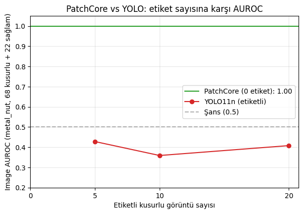
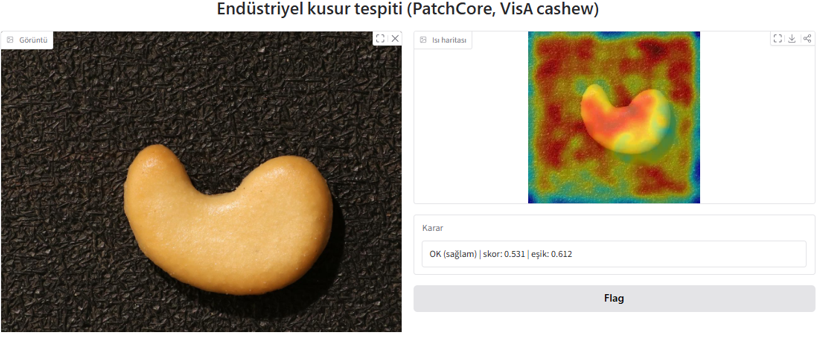
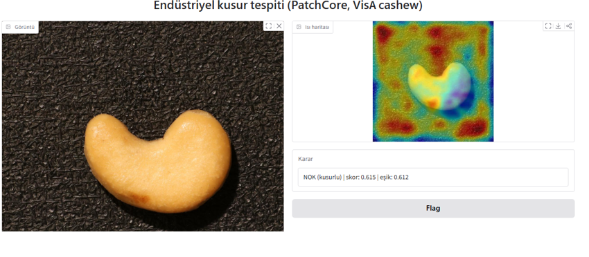

# Industrial Anomaly Detection: PatchCore vs. Supervised YOLO

Unsupervised visual defect detection trained only on defect-free images (PatchCore, PaDiM via
[anomalib](https://github.com/open-edge-platform/anomalib) 2.7.0), compared against supervised YOLO11n with few labels,
plus a simulated lighting-shift test, ONNX CPU benchmark, and a Gradio demo.

> **Scope note:** I used anomalib's implementations; I did not re-implement PatchCore from scratch.
> No self-collected data: lighting changes are **simulated** brightness scaling, not real lighting variation.

## Key findings

- **Unsupervised works with zero defect labels.** PatchCore reached an average image AUROC of **0.988** on 4 MVTec AD categories and **0.859** on 4 VisA categories (anomalib default settings).
- **YOLO11n with 5-20 labeled defects stayed near chance** (image AUROC 0.36-0.43) on MVTec `metal_nut`, while PatchCore on the same 90 test images scored 1.0. This is a result for *this setup* (untuned training, one category), not a claim that YOLO is always worse.
- **Ranking quality survives brightness changes, a fixed threshold does not.** On VisA `cashew`, AUROC stayed at 0.956-0.969 for brightness x0.5-x1.5, but the false-alarm rate with a threshold fixed at normal lighting rose from 6% to 28-100%.
- **PatchCore is slow on CPU:** about 1 FPS in my Kaggle CPU environment (ONNX Runtime ~1.2 FPS vs PyTorch ~0.95 FPS).

## Results

All image AUROC values were computed manually with `sklearn.metrics.roc_auc_score` from per-image anomaly scores.
Single run per setting; PatchCore's coreset sampling is random, so third-decimal differences between runs are expected.

### 1. PatchCore vs. PaDiM on MVTec AD (full test sets)

| Category | PatchCore | PaDiM |
|---|---|---|
| metal_nut | 0.997 | 0.998 |
| leather | 1.000 | 1.000 |
| screw | 0.961 | 0.956 |
| transistor | 0.993 | 0.994 |
| **Mean** | **0.988** | **0.987** |

The two models are indistinguishable on these categories (differences of ~0.001-0.005 on small test sets). `screw` is the hardest category for both.
Anomaly maps from PatchCore overlap the ground-truth masks on the `metal_nut` examples I inspected (6 samples, all one defect type, so not representative of all defect types).

### 2. PatchCore (0 labels) vs. YOLO11n (5/10/20 labels), MVTec `metal_nut`

| Labeled defective images | YOLO11n image AUROC | PatchCore image AUROC |
|---|---|---|
| 0 | n/a | 1.000 |
| 5 | 0.428 | 1.000 |
| 10 | 0.359 | 1.000 |
| 20 | 0.408 | 1.000 |

**Protocol**
- YOLO labels: bounding boxes derived from MVTec ground-truth masks (`findContours` + `boundingRect`), single class "defect".
- Each training set: n defective + n defect-free images (empty labels). Defective training/validation images were taken from MVTec's test set and **excluded from evaluation**.
- Evaluation: the same 90 images for both methods (68 defective + 22 good). YOLO image score = highest box confidence (0 if no box), `conf=0.001`.
- YOLO11n fine-tuned from COCO weights: 100 epochs, patience 30, imgsz 640, batch 8, 10-image validation set.

**Diagnosis:** the YOLO models drew many large, overlapping high-confidence boxes on good and defective images alike (mean top score 0.897 defective vs. 0.915 good for n=20). They appear to have learned "nut present = defect", but this is an interpretation from a few visualized samples, not a proven cause.

**Limits:** one category, one seed, no hyperparameter tuning, tiny validation set. I did not test larger label counts, so the point where YOLO catches up (if any) is not found.

A bug I caught during this experiment: files from different defect folders share names (`000.png`), so my first dataset build silently overwrote images (n=10 became 8, n=20 became 15). I fixed the naming, rebuilt the datasets, verified the counts (5/10/20) and retrained.

### 3. PatchCore on VisA (full test sets, anomalib default settings)

| Category | Image AUROC |
|---|---|
| cashew | 0.966 |
| capsules | 0.735 |
| pcb1 | 0.931 |
| macaroni1 | 0.807 |
| **Mean** | **0.859** |

Performance drops substantially on `capsules` and `macaroni1` (small defects, multi-object scenes). I did not tune resolution or layers, so I cannot say whether this is a model limit or a settings limit.

### 4. Simulated lighting shift (VisA `cashew`)

PatchCore was trained under normal lighting. The threshold was set at the 95th percentile of good-image scores at x1.0 and **kept fixed**. Test images (50 good, 100 defective) were multiplied by a brightness factor (clipped to 0-255).

| Brightness | AUROC | False-alarm rate | Defects caught |
|---|---|---|---|
| x0.5 | 0.965 | 0.36 | 1.00 |
| x0.75 | 0.967 | 0.06 | 0.85 |
| x1.0 | 0.961 | 0.06 | 0.78 |
| x1.25 | 0.969 | 0.28 | 0.98 |
| x1.5 | 0.956 | 1.00 | 1.00 |

"Defects caught = 1.0" together with "false alarms = 1.0" means the system flags everything, not that it works.
Takeaway: AUROC (threshold-free ranking) hides a failure that appears once a fixed operating threshold is used, so controlled lighting or normalization is needed in practice.
**Limits:** uniform brightness scaling is not real lighting variation (no shadows, reflections, or color temperature); one category; one run; false-alarm differences of a few images are within noise on 50 good samples.

### 5. ONNX export and CPU speed (VisA `cashew`, Kaggle CPU)

| Runtime | Input | Per image | FPS |
|---|---|---|---|
| PyTorch | 224x224, batch 1 | ~1055 ms | 0.95 |
| ONNX Runtime | 224x224, batch 2 | ~829 ms | 1.21 |

Rough comparison from a single measurement: batch size and pre/post-processing are not identical between the two runs, and the ONNX model's built-in `pred_label` threshold flagged every image as defective, so I did not use it.
The export printed a `Resize` version-conversion error, but the file loaded and, on 5 good/defective pairs, gave the defective image the higher score each time. I did not evaluate AUROC of the ONNX model on a full test set.
Peak process memory during the benchmark was about 4.2 GB (includes training, so it is not the model's inference footprint).

## Demo

Gradio app: upload an image, view the heatmap and OK/NOK decision, adjust the threshold with a slider.

| OK | NOK |
|---|---|
|  |  |

The demo threshold (0.612) is the 95th percentile of 24 good test images' scores, so it is based on a small sample and is not a production setting. The heatmap is normalized per image, so good images can also show red regions: the decision comes from the score, not the heatmap.

## Repository

| File | Content |
|---|---|
| `01_veri_ve_pytorch_temelleri.ipynb` | MVTec exploration, tensors, Dataset/DataLoader, ResNet feature maps |
| `02_patchcore_anomalib.ipynb` | PatchCore and PaDiM on 4 MVTec categories, heatmaps |
| `03_yolo_karsilastirma.ipynb` | Mask-to-box labels, YOLO11n with 5/10/20 labels, comparison |
| `04_visa_isik_testi.ipynb` | VisA benchmark, lighting test, ONNX speed, Gradio demo |
| `ana_grafik.png` | PatchCore vs. YOLO plot |

Model files (365 MB, exceeds GitHub's limit): (https://drive.google.com/drive/folders/1kfuGQy_Vl0Ds3gg8E1BDH6Z6jHAdPN0w?usp=drive_link)
`model.onnx` and `model.onnx.data` must stay in the same folder under these names.

## Reproduce

Notebooks were run on Kaggle (T4 GPU). Main dependencies: `anomalib==2.7.0`, `ultralytics`, `onnx`, `onnxruntime`, `onnxscript`, `gradio`, `scikit-learn`, `opencv-python`.

Note: running anomalib directly inside a Kaggle notebook raised a `RecursionError` from progress bars (`tqdm`/`rich`) in my environment, so the training code was written to `.py` files and executed as separate processes (`!python script.py`).

## Datasets and references

- MVTec AD: Bergmann et al., "A Comprehensive Real-World Dataset for Unsupervised Anomaly Detection", CVPR 2019. License: CC BY-NC-SA 4.0 (non-commercial use).
- VisA: Zou et al., "SPot-the-Difference Self-Supervised Pre-training for Anomaly Detection and Segmentation", ECCV 2022. Sources disagree on its license (CC BY 4.0 vs. CC BY-NC-SA 4.0); treat it as non-commercial.
- PatchCore: Roth et al., "Towards Total Recall in Industrial Anomaly Detection", CVPR 2022.
- PaDiM: Defard et al., "PaDiM: a Patch Distribution Modeling Framework for Anomaly Detection and Localization", 2020.
- anomalib: Akcay et al., "Anomalib: A Deep Learning Library for Anomaly Detection", 2022.
- YOLO11: Ultralytics.

## Limitations (summary)

- Reused library implementations; no from-scratch PatchCore.
- No self-collected data; lighting test is a simulation.
- Mostly single runs, single categories for the YOLO and lighting experiments, small test sets.
- No hyperparameter tuning (PatchCore resolution/layers, YOLO training schedule).
- Pixel-level metrics (pixel AUROC, PRO) were not computed. The `image_AUROC` printed by anomalib's `engine.test` was inconsistent with the manual calculation in my environment (0.5 vs. 0.998), so I used manually computed values.
